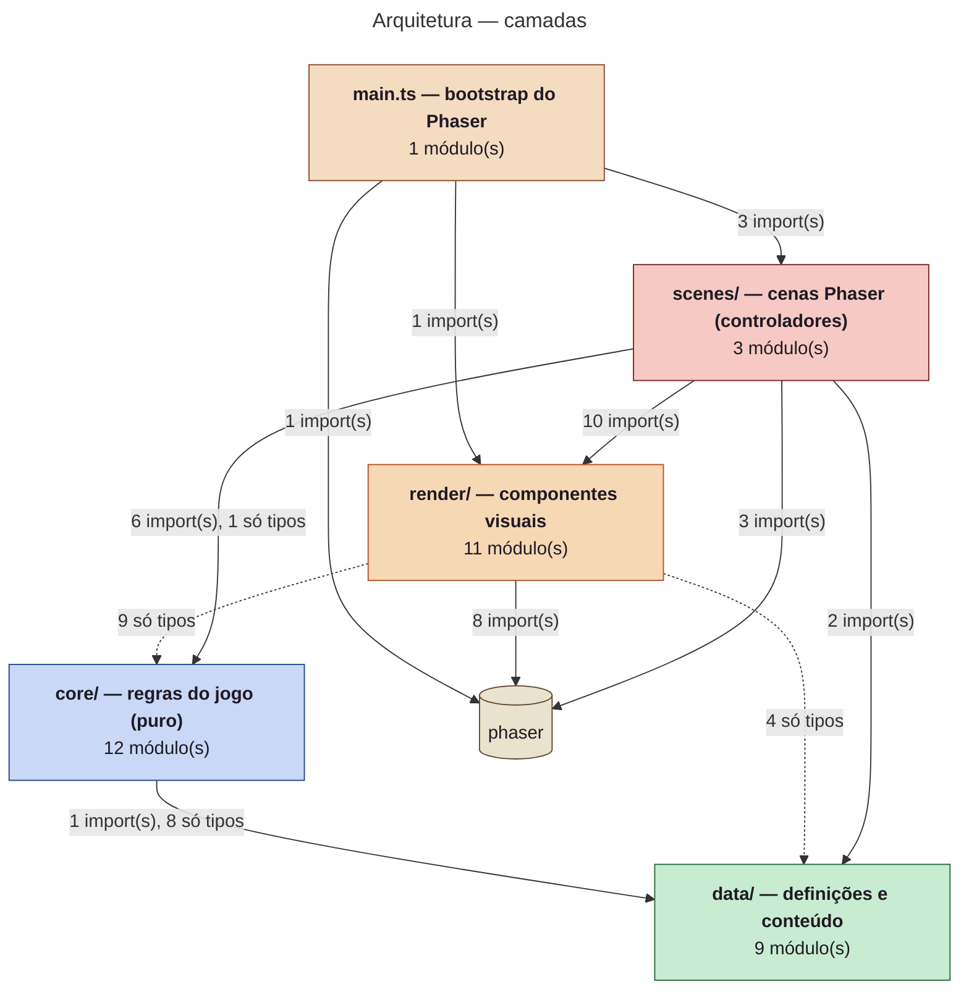

<!-- GERADO AUTOMATICAMENTE por scripts/diagrams/generate.ts — não edite à mão. Rode `npm run diagrams`. -->

# Arquitetura do software

Gerado a partir dos imports reais com dependency-cruiser.

## Camadas

Dependências entre camadas de `src/` e pacotes externos. Setas tracejadas = apenas `import type`. Regras em `.dependency-cruiser.cjs` (`npm run lint:arch`).

## Módulos

Cada arquivo de `src/` e seus imports de valor (os `import type` estão resumidos na visão de camadas).

```mermaid
---
title: Arquitetura — dependências entre módulos
---
flowchart TB
  subgraph layer_app["src"]
    src_main_ts["main.ts"]
  end
  subgraph layer_scenes["src/scenes"]
    src_scenes_BattleScene_ts["BattleScene.ts"]
    src_scenes_BootScene_ts["BootScene.ts"]
    src_scenes_TitleScene_ts["TitleScene.ts"]
  end
  subgraph layer_render["src/render"]
    src_render_ActionMenu_ts["ActionMenu.ts"]
    src_render_ForecastPanel_ts["ForecastPanel.ts"]
    src_render_MapView_ts["MapView.ts"]
    src_render_PhaseBanner_ts["PhaseBanner.ts"]
    src_render_SidePanel_ts["SidePanel.ts"]
    src_render_UnitSprite_ts["UnitSprite.ts"]
    src_render_art_ts["art.ts"]
    src_render_effects_ts["effects.ts"]
    src_render_layout_ts["layout.ts"]
    src_render_pixel_canvas_ts["pixel-canvas.ts"]
    src_render_textures_ts["textures.ts"]
  end
  subgraph layer_core["src/core"]
    src_core_ai_ts["ai.ts"]
    src_core_battle_map_ts["battle-map.ts"]
    src_core_battle_state_ts["battle-state.ts"]
    src_core_combat_ts["combat.ts"]
    src_core_faction_ts["faction.ts"]
    src_core_grid_ts["grid.ts"]
    src_core_leveling_ts["leveling.ts"]
    src_core_objectives_ts["objectives.ts"]
    src_core_pathfinding_ts["pathfinding.ts"]
    src_core_rng_ts["rng.ts"]
    src_core_unit_factory_ts["unit-factory.ts"]
    src_core_unit_ts["unit.ts"]
  end
  subgraph layer_data["src/data"]
    src_data_chapter1_index_ts["chapter1/index.ts"]
    src_data_chapter1_stage1_ts["chapter1/stage1.ts"]
    src_data_characters_ts["characters.ts"]
    src_data_classes_ts["classes.ts"]
    src_data_index_ts["index.ts"]
    src_data_stats_ts["stats.ts"]
    src_data_terrain_ts["terrain.ts"]
    src_data_types_ts["types.ts"]
    src_data_weapons_ts["weapons.ts"]
  end
  ext_phaser[("phaser")]:::external
  src_core_ai_ts --> src_core_combat_ts
  src_core_ai_ts --> src_core_faction_ts
  src_core_ai_ts --> src_core_grid_ts
  src_core_ai_ts --> src_core_pathfinding_ts
  src_core_battle_state_ts --> src_core_battle_map_ts
  src_core_battle_state_ts --> src_core_combat_ts
  src_core_battle_state_ts --> src_core_faction_ts
  src_core_battle_state_ts --> src_core_grid_ts
  src_core_battle_state_ts --> src_core_leveling_ts
  src_core_battle_state_ts --> src_core_pathfinding_ts
  src_core_battle_state_ts --> src_core_rng_ts
  src_core_battle_state_ts --> src_core_unit_factory_ts
  src_core_battle_state_ts --> src_core_unit_ts
  src_core_combat_ts --> src_core_grid_ts
  src_core_pathfinding_ts --> src_core_faction_ts
  src_core_pathfinding_ts --> src_core_grid_ts
  src_core_unit_factory_ts --> src_core_unit_ts
  src_core_unit_factory_ts --> src_data_index_ts
  src_data_chapter1_index_ts --> src_data_chapter1_stage1_ts
  src_data_chapter1_stage1_ts --> src_data_terrain_ts
  src_data_characters_ts --> src_data_stats_ts
  src_data_classes_ts --> src_data_stats_ts
  src_data_index_ts --> src_data_chapter1_index_ts
  src_data_index_ts --> src_data_characters_ts
  src_data_index_ts --> src_data_classes_ts
  src_data_index_ts --> src_data_terrain_ts
  src_data_index_ts --> src_data_weapons_ts
  src_main_ts --> ext_phaser
  src_main_ts --> src_render_layout_ts
  src_main_ts --> src_scenes_BattleScene_ts
  src_main_ts --> src_scenes_BootScene_ts
  src_main_ts --> src_scenes_TitleScene_ts
  src_render_ActionMenu_ts --> ext_phaser
  src_render_ActionMenu_ts --> src_render_layout_ts
  src_render_art_ts --> src_render_layout_ts
  src_render_art_ts --> src_render_pixel_canvas_ts
  src_render_effects_ts --> ext_phaser
  src_render_effects_ts --> src_render_layout_ts
  src_render_ForecastPanel_ts --> ext_phaser
  src_render_ForecastPanel_ts --> src_render_layout_ts
  src_render_MapView_ts --> ext_phaser
  src_render_MapView_ts --> src_render_layout_ts
  src_render_MapView_ts --> src_render_pixel_canvas_ts
  src_render_MapView_ts --> src_render_textures_ts
  src_render_PhaseBanner_ts --> ext_phaser
  src_render_PhaseBanner_ts --> src_render_layout_ts
  src_render_SidePanel_ts --> ext_phaser
  src_render_SidePanel_ts --> src_render_layout_ts
  src_render_textures_ts --> ext_phaser
  src_render_textures_ts --> src_render_art_ts
  src_render_UnitSprite_ts --> ext_phaser
  src_render_UnitSprite_ts --> src_render_layout_ts
  src_render_UnitSprite_ts --> src_render_textures_ts
  src_scenes_BattleScene_ts --> ext_phaser
  src_scenes_BattleScene_ts --> src_core_ai_ts
  src_scenes_BattleScene_ts --> src_core_battle_state_ts
  src_scenes_BattleScene_ts --> src_core_combat_ts
  src_scenes_BattleScene_ts --> src_core_grid_ts
  src_scenes_BattleScene_ts --> src_core_objectives_ts
  src_scenes_BattleScene_ts --> src_core_pathfinding_ts
  src_scenes_BattleScene_ts --> src_data_index_ts
  src_scenes_BattleScene_ts --> src_render_ActionMenu_ts
  src_scenes_BattleScene_ts --> src_render_effects_ts
  src_scenes_BattleScene_ts --> src_render_ForecastPanel_ts
  src_scenes_BattleScene_ts --> src_render_layout_ts
  src_scenes_BattleScene_ts --> src_render_MapView_ts
  src_scenes_BattleScene_ts --> src_render_PhaseBanner_ts
  src_scenes_BattleScene_ts --> src_render_SidePanel_ts
  src_scenes_BattleScene_ts --> src_render_UnitSprite_ts
  src_scenes_BootScene_ts --> ext_phaser
  src_scenes_BootScene_ts --> src_data_index_ts
  src_scenes_BootScene_ts --> src_render_textures_ts
  src_scenes_TitleScene_ts --> ext_phaser
  src_scenes_TitleScene_ts --> src_render_layout_ts
  classDef external fill:#e9e2cc,stroke:#5c4630,color:#1f1a24
```

