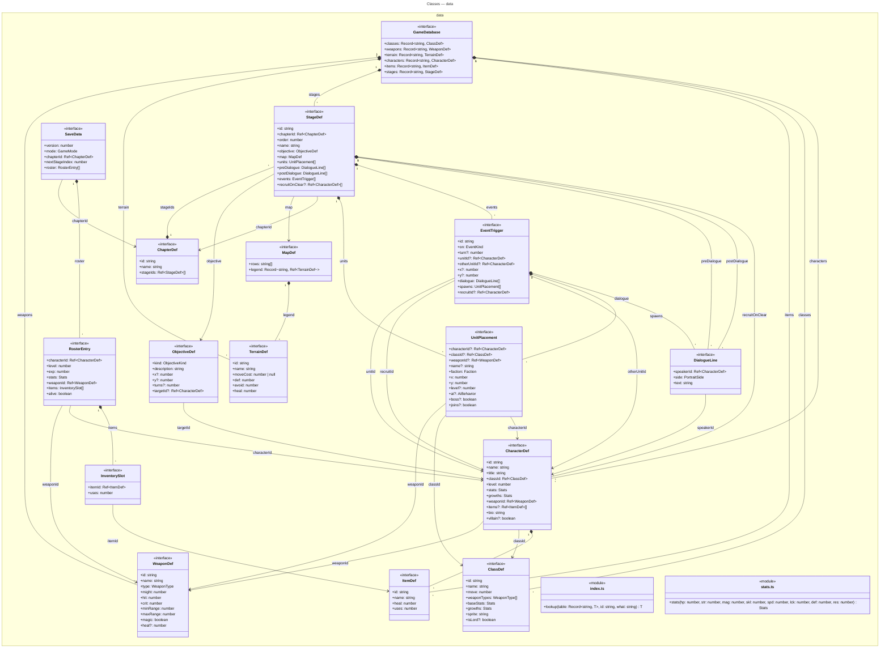
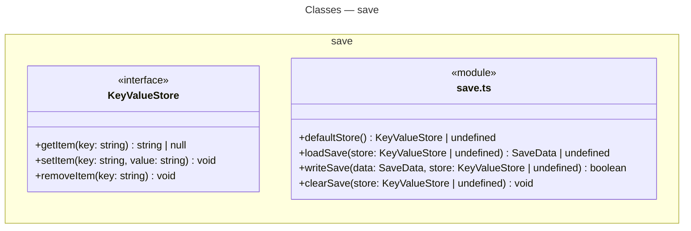
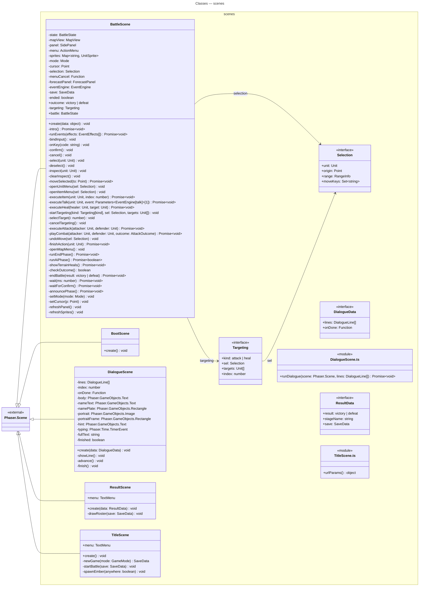

<!-- GERADO AUTOMATICAMENTE por scripts/diagrams/generate.ts — não edite à mão. Rode `npm run diagrams`. -->

# Diagrama de classes

Extraído do AST TypeScript com ts-morph. Legenda: `<|--` herança, `<|..` implementação, `*--` composição (coleção), `-->` associação; `<<module>>` = arquivo que exporta funções; `$` = estático.

## Visão geral

Todas as classes, interfaces e módulos de funções de `src/`, agrupados por camada, sem membros.

```mermaid
---
title: Classes — visão geral
---
classDiagram
  direction LR
  namespace core {
    class AiPlan {
      <<interface>>
    }
    class mod_core_ai["ai.ts"] {
      <<module>>
    }
    class BattleMap
    class BattleState
    class BattleOptions {
      <<interface>>
    }
    class ExpGain {
      <<interface>>
    }
    class TerrainHeal {
      <<interface>>
    }
    class HealOutcome {
      <<interface>>
    }
    class AttackOutcome {
      <<interface>>
    }
    class RangeInfo {
      <<interface>>
    }
    class mod_core_campaign["campaign.ts"] {
      <<module>>
    }
    class StrikeStats {
      <<interface>>
    }
    class Forecast {
      <<interface>>
    }
    class Strike {
      <<interface>>
    }
    class CombatResult {
      <<interface>>
    }
    class mod_core_combat["combat.ts"] {
      <<module>>
    }
    class EventEngine
    class EventEffects {
      <<interface>>
    }
    class mod_core_faction["faction.ts"] {
      <<module>>
    }
    class Point {
      <<interface>>
    }
    class mod_core_grid["grid.ts"] {
      <<module>>
    }
    class LevelUp {
      <<interface>>
    }
    class mod_core_leveling["leveling.ts"] {
      <<module>>
    }
    class mod_core_objectives["objectives.ts"] {
      <<module>>
    }
    class ReachNode {
      <<interface>>
    }
    class mod_core_pathfinding["pathfinding.ts"] {
      <<module>>
    }
    class Rng
    class mod_core_unit_factory["unit-factory.ts"] {
      <<module>>
    }
    class Unit
    class CarriedItem {
      <<interface>>
    }
    class UnitInit {
      <<interface>>
    }
  }
  namespace data {
    class GameDatabase {
      <<interface>>
    }
    class mod_data_index["index.ts"] {
      <<module>>
    }
    class mod_data_stats["stats.ts"] {
      <<module>>
    }
    class TerrainDef {
      <<interface>>
    }
    class WeaponDef {
      <<interface>>
    }
    class ItemDef {
      <<interface>>
    }
    class InventorySlot {
      <<interface>>
    }
    class ClassDef {
      <<interface>>
    }
    class CharacterDef {
      <<interface>>
    }
    class MapDef {
      <<interface>>
    }
    class UnitPlacement {
      <<interface>>
    }
    class ObjectiveDef {
      <<interface>>
    }
    class DialogueLine {
      <<interface>>
    }
    class EventTrigger {
      <<interface>>
    }
    class StageDef {
      <<interface>>
    }
    class ChapterDef {
      <<interface>>
    }
    class RosterEntry {
      <<interface>>
    }
    class SaveData {
      <<interface>>
    }
  }
  namespace render {
    class ActionMenu
    class MenuOption {
      <<interface>>
    }
    class UnitArtSpec {
      <<interface>>
    }
    class mod_render_art["art.ts"] {
      <<module>>
    }
    class mod_render_effects["effects.ts"] {
      <<module>>
    }
    class ForecastPanel
    class MapView
    class mod_render_PhaseBanner["PhaseBanner.ts"] {
      <<module>>
    }
    class PixelCanvas
    class mod_render_pixel_canvas["pixel-canvas.ts"] {
      <<module>>
    }
    class mod_render_sfx["sfx.ts"] {
      <<module>>
    }
    class SidePanel
    class TextMenu
    class TextMenuOption {
      <<interface>>
    }
    class mod_render_textures["textures.ts"] {
      <<module>>
    }
    class UnitSprite
  }
  namespace save {
    class KeyValueStore {
      <<interface>>
    }
    class mod_save_save["save.ts"] {
      <<module>>
    }
  }
  namespace scenes {
    class BattleScene
    class Targeting {
      <<interface>>
    }
    class Selection {
      <<interface>>
    }
    class BootScene
    class DialogueScene
    class DialogueData {
      <<interface>>
    }
    class mod_scenes_DialogueScene["DialogueScene.ts"] {
      <<module>>
    }
    class ResultScene
    class ResultData {
      <<interface>>
    }
    class TitleScene
    class mod_scenes_TitleScene["TitleScene.ts"] {
      <<module>>
    }
  }
  class Phaser_Scene["Phaser.Scene"] {
    <<external>>
  }
  ActionMenu "1" *-- "*" MenuOption : options
  AiPlan --> Point : moveTo
  AiPlan --> Unit : target
  AiPlan --> Unit : unit
  AttackOutcome "1" *-- "*" ExpGain : exp
  AttackOutcome --> CombatResult : result
  BattleMap "1" *-- "*" TerrainDef : tiles
  BattleOptions "1" *-- "*" Unit : units
  BattleScene "1" *-- "*" UnitSprite : sprites
  BattleScene --> ActionMenu : menu
  BattleScene --> BattleState : state
  BattleScene --> EventEngine : eventEngine
  BattleScene --> ForecastPanel : forecastPanel
  BattleScene --> MapView : mapView
  BattleScene --> Point : cursor
  BattleScene --> SaveData : save
  BattleScene --> Selection : selection
  BattleScene --> SidePanel : panel
  BattleScene --> Targeting : targeting
  BattleState "1" *-- "*" TerrainHeal : phaseHeals
  BattleState "1" *-- "*" Unit : units
  BattleState --> BattleMap : map
  BattleState --> GameDatabase : db
  BattleState --> Rng : rng
  BattleState --> StageDef : stage
  CarriedItem --> ItemDef : def
  ChapterDef "1" *-- "*" StageDef : stageIds
  CharacterDef "1" *-- "*" ItemDef : items
  CharacterDef --> ClassDef : classId
  CharacterDef --> WeaponDef : weaponId
  CombatResult "1" *-- "*" Strike : strikes
  DialogueData "1" *-- "*" DialogueLine : lines
  DialogueLine --> CharacterDef : speakerId
  DialogueScene "1" *-- "*" DialogueLine : lines
  EventEffects "1" *-- "*" DialogueLine : dialogue
  EventEffects "1" *-- "*" Unit : recruited
  EventEffects "1" *-- "*" Unit : spawned
  EventEffects --> EventTrigger : event
  EventEngine --> BattleState : state
  EventTrigger "1" *-- "*" DialogueLine : dialogue
  EventTrigger "1" *-- "*" UnitPlacement : spawns
  EventTrigger --> CharacterDef : otherUnitId
  EventTrigger --> CharacterDef : recruitId
  EventTrigger --> CharacterDef : unitId
  ExpGain "1" *-- "*" LevelUp : levelUps
  ExpGain --> Unit : unit
  Forecast --> StrikeStats : attackerStats
  Forecast --> StrikeStats : defenderStats
  Forecast --> Unit : attacker
  Forecast --> Unit : defender
  GameDatabase "1" *-- "*" CharacterDef : characters
  GameDatabase "1" *-- "*" ClassDef : classes
  GameDatabase "1" *-- "*" ItemDef : items
  GameDatabase "1" *-- "*" StageDef : stages
  GameDatabase "1" *-- "*" TerrainDef : terrain
  GameDatabase "1" *-- "*" WeaponDef : weapons
  HealOutcome --> ExpGain : exp
  InventorySlot --> ItemDef : itemId
  MapDef "1" *-- "*" TerrainDef : legend
  MapView --> BattleMap : map
  ObjectiveDef --> CharacterDef : targetId
  Phaser_Scene <|-- BattleScene
  Phaser_Scene <|-- BootScene
  Phaser_Scene <|-- DialogueScene
  Phaser_Scene <|-- ResultScene
  Phaser_Scene <|-- TitleScene
  RangeInfo "1" *-- "*" Point : attack
  RangeInfo "1" *-- "*" Point : move
  RangeInfo "1" *-- "*" ReachNode : reach
  ReachNode --> Point : point
  ResultData --> SaveData : save
  ResultScene --> TextMenu : menu
  RosterEntry "1" *-- "*" InventorySlot : items
  RosterEntry --> CharacterDef : characterId
  RosterEntry --> WeaponDef : weaponId
  SaveData "1" *-- "*" RosterEntry : roster
  SaveData --> ChapterDef : chapterId
  Selection --> Point : origin
  Selection --> RangeInfo : range
  Selection --> Unit : unit
  StageDef "1" *-- "*" CharacterDef : recruitOnClear
  StageDef "1" *-- "*" DialogueLine : postDialogue
  StageDef "1" *-- "*" DialogueLine : preDialogue
  StageDef "1" *-- "*" EventTrigger : events
  StageDef "1" *-- "*" UnitPlacement : units
  StageDef --> ChapterDef : chapterId
  StageDef --> MapDef : map
  StageDef --> ObjectiveDef : objective
  Targeting "1" *-- "*" Unit : targets
  Targeting --> Selection : sel
  TerrainHeal --> Unit : unit
  TextMenu "1" *-- "*" TextMenuOption : options
  TitleScene --> TextMenu : menu
  Unit "1" *-- "*" CarriedItem : items
  Unit --> ClassDef : classDef
  Unit --> WeaponDef : weapon
  UnitInit "1" *-- "*" CarriedItem : items
  UnitInit --> ClassDef : classDef
  UnitInit --> Point : position
  UnitInit --> WeaponDef : weapon
  UnitPlacement --> CharacterDef : characterId
  UnitPlacement --> ClassDef : classId
  UnitPlacement --> WeaponDef : weaponId
  UnitSprite --> Unit : unit
```

## Camada `core`

Atributos e métodos dos tipos em `src/core/`. Relações apenas internas à camada.

```mermaid
---
title: Classes — core
---
classDiagram
  direction LR
  namespace core {
    class AiPlan {
      <<interface>>
      +unit: Unit
      +moveTo: Point
      +target?: Unit
      +score: number
    }
    class mod_core_ai["ai.ts"] {
      <<module>>
      +scoreAttack(state: BattleState, unit: Unit, from: Point, target: Unit) number
      +planAction(state: BattleState, unit: Unit) AiPlan
      +actionOrder(state: BattleState, units: Unit[]) Unit[]
    }
    class BattleMap {
      +width: number
      +height: number
      -tiles: TerrainDef[][]
      +inBounds(p: Point) boolean
      +terrainAt(p: Point) TerrainDef
      +moveCost(p: Point) number | null
    }
    class BattleState {
      +stage: StageDef
      +map: BattleMap
      +units: Unit[]
      +db: GameDatabase
      +rng: Rng
      +turn: number
      +phase: Faction
      +seized: boolean
      +phaseHeals: TerrainHeal[]
      -nextIndex: number
      +livingUnits: Unit[]
      +unitAt(p: Point) Unit | undefined
      +unitsOf(faction: Faction) Unit[]
      +rangeFor(unit: Unit) RangeInfo
      +moveUnit(unit: Unit, to: Point) Point[]
      +spawnUnit(p: UnitPlacement) Unit
      -nearestFree(start: Point) Point
      +targetsInRange(unit: Unit) Unit[]
      +attack(attacker: Unit, defender: Unit) AttackOutcome
      +healTargets(unit: Unit) Unit[]
      +healUnit(healer: Unit, target: Unit) HealOutcome
      +useItem(unit: Unit, index: number) number
      +canSeize(unit: Unit) boolean
      +seize(unit: Unit) void
      +undoMove(unit: Unit, origin: Point) void
      +wait(unit: Unit) void
      +phaseExhausted() boolean
      +endPhase() Faction
    }
    class BattleOptions {
      <<interface>>
      +seed?: number
      +units?: Unit[]
    }
    class ExpGain {
      <<interface>>
      +unit: Unit
      +amount: number
      +levelUps: LevelUp[]
    }
    class TerrainHeal {
      <<interface>>
      +unit: Unit
      +amount: number
    }
    class HealOutcome {
      <<interface>>
      +amount: number
      +exp?: ExpGain
    }
    class AttackOutcome {
      <<interface>>
      +result: CombatResult
      +exp: ExpGain[]
    }
    class RangeInfo {
      <<interface>>
      +reach: Map~string, ReachNode~
      +move: Point[]
      +attack: Point[]
    }
    class mod_core_campaign["campaign.ts"] {
      <<module>>
      +newCampaign(mode: GameMode, chapterId: any) SaveData
      +buildStageUnits(stage: StageDef, save: SaveData, db: GameDatabase) Unit[]
      +applyVictory(save: SaveData, state: BattleState) SaveData
      +livingRoster(save: SaveData) RosterEntry[]
    }
    class StrikeStats {
      <<interface>>
      +damage: number
      +hit: number
      +crit: number
      +strikes: number
    }
    class Forecast {
      <<interface>>
      +attacker: Unit
      +defender: Unit
      +attackerStats: StrikeStats
      +defenderStats: StrikeStats
    }
    class Strike {
      <<interface>>
      +attackerId: string
      +targetId: string
      +hit: boolean
      +crit: boolean
      +damage: number
      +targetHpAfter: number
    }
    class CombatResult {
      <<interface>>
      +strikes: Strike[]
      +attackerDied: boolean
      +defenderDied: boolean
    }
    class mod_core_combat["combat.ts"] {
      <<module>>
      +weaponTriangle(a: WeaponType, b: WeaponType) -1 | 0 | 1
      +canAttackWith(unit: Unit) boolean
      +inWeaponRange(unit: Unit, from: Point, target: Point) boolean
      +strikeStats(a: Unit, d: Unit, dTerrain: TerrainDef) Omit~StrikeStats, strikes~
      +forecast(map: BattleMap, attacker: Unit, defender: Unit, from: Point) Forecast
      +resolveCombat(map: BattleMap, attacker: Unit, defender: Unit, rng: Rng) CombatResult
    }
    class EventEngine {
      -state: BattleState
      -fired: Set~string~
      +hasFired(id: string) boolean
      -pending(kind: EventTrigger[on]) EventTrigger[]
      +turnStart() EventEffects[]
      +unitDefeated(unit: Unit) EventEffects[]
      +tileReached(unit: Unit) EventEffects[]
      +talkOptions(unit: Unit) [EventTrigger, Unit][]
      +talk(unit: Unit, event: EventTrigger) EventEffects
      -fire(event: EventTrigger) EventEffects
    }
    class EventEffects {
      <<interface>>
      +event: EventTrigger
      +dialogue: DialogueLine[]
      +spawned: Unit[]
      +recruited: Unit[]
    }
    class mod_core_faction["faction.ts"] {
      <<module>>
      +areHostile(a: Faction, b: Faction) boolean
    }
    class Point {
      <<interface>>
      +x: number
      +y: number
    }
    class mod_core_grid["grid.ts"] {
      <<module>>
      +pointKey(p: Point) string
      +parseKey(key: string) Point
      +samePoint(a: Point, b: Point) boolean
      +manhattan(a: Point, b: Point) number
      +neighbors(p: Point) Point[]
      +tilesInRange(p: Point, min: number, max: number) Point[]
    }
    class LevelUp {
      <<interface>>
      +level: number
      +gains: Stats
    }
    class mod_core_leveling["leveling.ts"] {
      <<module>>
      +combatExp(unit: Unit, enemy: Unit, dealtDamage: boolean, killed: boolean) number
      +gainExp(unit: Unit, amount: number, rng: Rng) LevelUp[]
    }
    class mod_core_objectives["objectives.ts"] {
      <<module>>
      +evaluate(state: BattleState) Outcome
    }
    class ReachNode {
      <<interface>>
      +point: Point
      +cost: number
      +prev: string | null
    }
    class mod_core_pathfinding["pathfinding.ts"] {
      <<module>>
      +computeReach(map: BattleMap, unit: Unit, occupancy: Occupancy) Map~string, ReachNode~
      +movementTiles(reach: Map~string, ReachNode~, unit: Unit, occupancy: Occupancy) Point[]
      +attackTiles(map: BattleMap, destinations: Point[], minRange: number, maxRange: number) Point[]
      +buildPath(reach: Map~string, ReachNode~, target: Point) Point[]
      +distanceField(map: BattleMap, targets: Point[]) Map~string, number~
    }
    class Rng {
      -state: number
      +next() number
      +int(max: number) number
      +roll(percent: number) boolean
    }
    class mod_core_unit_factory["unit-factory.ts"] {
      <<module>>
      +genericStats(base: Stats, growths: Stats, level: number) Stats
      +createUnit(p: UnitPlacement, db: GameDatabase, index: number) Unit
    }
    class Unit {
      +id: string
      +name: string
      +faction: Faction
      +classDef: ClassDef
      +characterId: string
      +ai: AiBehavior
      +boss: boolean
      +weapon: WeaponDef
      +level: number
      +exp: number
      +stats: Stats
      +growths: Stats
      +hp: number
      +x: number
      +y: number
      +hasActed: boolean
      +items: CarriedItem[]
      +maxHp: number
      +move: number
      +isLord: boolean
      +position: Point
      +isAlive() boolean
      +canAct() boolean
      +takeDamage(amount: number) void
      +heal(amount: number) number
      +moveTo(p: Point) void
    }
    class CarriedItem {
      <<interface>>
      +def: ItemDef
      +uses: number
    }
    class UnitInit {
      <<interface>>
      +id: string
      +name: string
      +faction: Faction
      +classDef: ClassDef
      +weapon: WeaponDef
      +level: number
      +stats: Stats
      +growths: Stats
      +position: Point
      +characterId?: string
      +ai?: AiBehavior
      +boss?: boolean
      +items?: CarriedItem[]
      +exp?: number
      +hp?: number
    }
  }
  AiPlan --> Point : moveTo
  AiPlan --> Unit : target
  AiPlan --> Unit : unit
  AttackOutcome "1" *-- "*" ExpGain : exp
  AttackOutcome --> CombatResult : result
  BattleOptions "1" *-- "*" Unit : units
  BattleState "1" *-- "*" TerrainHeal : phaseHeals
  BattleState "1" *-- "*" Unit : units
  BattleState --> BattleMap : map
  BattleState --> Rng : rng
  CombatResult "1" *-- "*" Strike : strikes
  EventEffects "1" *-- "*" Unit : recruited
  EventEffects "1" *-- "*" Unit : spawned
  EventEngine --> BattleState : state
  ExpGain "1" *-- "*" LevelUp : levelUps
  ExpGain --> Unit : unit
  Forecast --> StrikeStats : attackerStats
  Forecast --> StrikeStats : defenderStats
  Forecast --> Unit : attacker
  Forecast --> Unit : defender
  HealOutcome --> ExpGain : exp
  RangeInfo "1" *-- "*" Point : attack
  RangeInfo "1" *-- "*" Point : move
  RangeInfo "1" *-- "*" ReachNode : reach
  ReachNode --> Point : point
  TerrainHeal --> Unit : unit
  Unit "1" *-- "*" CarriedItem : items
  UnitInit "1" *-- "*" CarriedItem : items
  UnitInit --> Point : position
```

## Camada `data`

Atributos e métodos dos tipos em `src/data/`. Relações apenas internas à camada.

## Camada `render`

Atributos e métodos dos tipos em `src/render/`. Relações apenas internas à camada.

```mermaid
---
title: Classes — render
---
classDiagram
  direction LR
  namespace render {
    class ActionMenu {
      -scene: Phaser.Scene
      -container: Phaser.GameObjects.Container
      -options: MenuOption[]
      -index: number
      -items: Phaser.GameObjects.Text[]
      -highlight: Phaser.GameObjects.Rectangle
      -onPick: Function
      +isOpen: boolean
      +open(x: number, y: number, options: MenuOption[], onPick: Function) void
      +moveSelection(delta: number) void
      +confirm() void
      +close() void
      -select(i: number) void
    }
    class MenuOption {
      <<interface>>
      +id: string
      +label: string
      +enabled?: boolean
    }
    class UnitArtSpec {
      <<interface>>
      +classId: string
      +weaponType: string
      +faction: Faction
    }
    class mod_render_art["art.ts"] {
      <<module>>
      +drawUnit(spec: UnitArtSpec) PixelCanvas
      +drawTerrain(terrainId: string, variant: number) PixelCanvas
    }
    class mod_render_effects["effects.ts"] {
      <<module>>
      +floatText(scene: Phaser.Scene, tileX: number, tileY: number, text: string, color: string, size: any) Promise~void~
      +levelUpPopup(scene: Phaser.Scene, unit: Unit, up: LevelUp) Promise~void~
      +outcomeBanner(scene: Phaser.Scene, text: string, color: number) Phaser.GameObjects.Container
    }
    class ForecastPanel {
      -scene: Phaser.Scene
      -container: Phaser.GameObjects.Container
      +show(f: Forecast) void
      +hide() void
      -column(u: Unit, s: StrikeStats, foe: Unit, x: number) Phaser.GameObjects.Text[]
    }
    class MapView {
      -scene: Phaser.Scene
      -map: BattleMap
      -highlights: Phaser.GameObjects.Graphics
      -pathLayer: Phaser.GameObjects.Graphics
      -cursor: Phaser.GameObjects.Graphics
      -cursorTween: Phaser.Tweens.Tween
      +toPixel(p: Point) object$
      +toTile(px: number, py: number) Point | null
      +showRanges(move: Point[], attack: Point[], attackKind: HighlightKind) void
      +clearRanges() void
      +showPath(path: Point[]) void
      +clearPath() void
      +moveCursor(p: Point) void
      +setCursorVisible(visible: boolean) void
      -fillTiles(tiles: Point[], color: number, alpha: number) void
      -drawCursor() void
      +destroy() void
    }
    class mod_render_PhaseBanner["PhaseBanner.ts"] {
      <<module>>
      +showPhaseBanner(scene: Phaser.Scene, label: string, faction: keyof typeof BANNER_COLOR) Promise~void~
    }
    class PixelCanvas {
      +width: number
      +height: number
      -pixels: (string | null)[]
      +set(x: number, y: number, color: string | null) void
      +get(x: number, y: number) string | null
      +fill(color: string) void
      +rect(x: number, y: number, w: number, h: number, color: string) void
      +stamp(template: readonly string[], palette: Record~string, string~, ox: any, oy: any) void
      +paint(ctx: CanvasRenderingContext2D) void
    }
    class mod_render_pixel_canvas["pixel-canvas.ts"] {
      <<module>>
      +hash2(x: number, y: number, seed: any) number
    }
    class mod_render_sfx["sfx.ts"] {
      <<module>>
      +isMuted() boolean
      +toggleMute() boolean
      +playSfx(scene: Phaser.Scene, name: SfxName) void
    }
    class SidePanel {
      -turnText: Phaser.GameObjects.Text
      -terrainText: Phaser.GameObjects.Text
      -unitTitle: Phaser.GameObjects.Text
      -unitText: Phaser.GameObjects.Text
      -hpBar: Phaser.GameObjects.Graphics
      -helpText: Phaser.GameObjects.Text
      +setTurn(turn: number, phase: keyof typeof PHASE_LABEL) void
      +setTerrain(t: TerrainDef) void
      +setUnit(u: Unit | undefined) void
      +setHelp(message: string) void
    }
    class TextMenu {
      -scene: Phaser.Scene
      -items: Phaser.GameObjects.Text[]
      -options: TextMenuOption[]
      -index: number
      -onPick: Function
      -done: boolean
      +selectedId: string
      -onKey(ev: KeyboardEvent) void
      -move(delta: number) void
      -select(i: number, silent: any) void
      -confirm() void
    }
    class TextMenuOption {
      <<interface>>
      +id: string
      +label: string
      +enabled?: boolean
    }
    class mod_render_textures["textures.ts"] {
      <<module>>
      +terrainTextureKey(terrainId: string, variant: number) string
      +unitTextureKey(sprite: string, weaponType: string, faction: Faction) string
      +generateTextures(scene: Phaser.Scene, db: GameDatabase) void
    }
    class UnitSprite {
      +unit: Unit
      -container: Phaser.GameObjects.Container
      -sprite: Phaser.GameObjects.Image
      -hpBar: Phaser.GameObjects.Graphics
      -scene: Phaser.Scene
      +applyTexture() void
      +fadeIn() Promise~void~
      +refresh() void
      +snap() void
      +walk(path: Point[], msPerTile: any) Promise~void~
      +lunge(toward: Point) Promise~void~
      +flash() void
      +dodge() void
      +fadeOut() Promise~void~
      +setSelected(selected: boolean) void
      +destroy() void
    }
  }
  ActionMenu "1" *-- "*" MenuOption : options
  TextMenu "1" *-- "*" TextMenuOption : options
```

## Camada `save`

Atributos e métodos dos tipos em `src/save/`. Relações apenas internas à camada.

## Camada `scenes`

Atributos e métodos dos tipos em `src/scenes/`. Relações apenas internas à camada.

