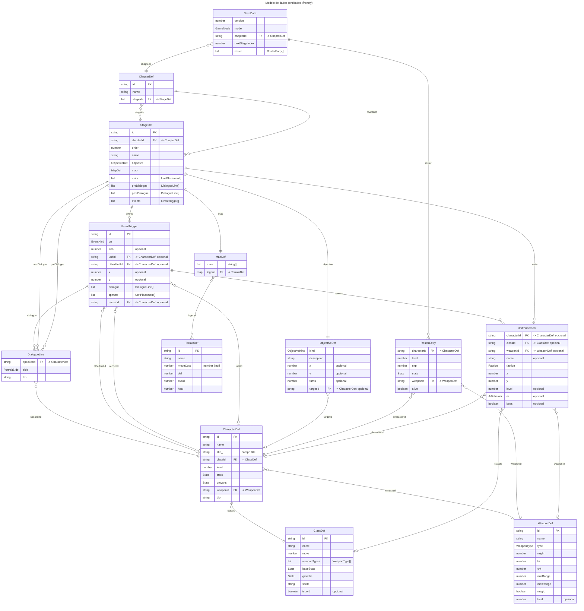

<!-- GERADO AUTOMATICAMENTE por scripts/diagrams/generate.ts — não edite à mão. Rode `npm run diagrams`. -->

# Diagrama Entidade-Relacionamento

Modelo de dados do jogo (definições estáticas em `src/data/` e o save). Para incluir uma nova entidade, marque a interface com `/** @entity Descrição */`.

## Entidades e relacionamentos

Interfaces marcadas com `@entity`. `Ref<X>` é chave estrangeira (FK) para X; listas e objetos embutidos são relações 1:N / 1:1.

## Entidades

| Entidade | Descrição | Arquivo |
|---|---|---|
| `ChapterDef` | Capítulo da campanha. | `src/data/types.ts` |
| `CharacterDef` | Personagem nomeado (jogável ou chefe). | `src/data/types.ts` |
| `ClassDef` | Classe de unidade: atributos-base, crescimento e armas permitidas. | `src/data/types.ts` |
| `DialogueLine` | Uma fala de diálogo. | `src/data/types.ts` |
| `EventTrigger` | Evento disparado durante a batalha. | `src/data/types.ts` |
| `MapDef` | Mapa de uma fase em texto: cada caractere é um terreno. | `src/data/types.ts` |
| `ObjectiveDef` | Condição de vitória de uma fase. | `src/data/types.ts` |
| `RosterEntry` | Estado salvo de um personagem entre fases. | `src/data/types.ts` |
| `SaveData` | Save do jogo (localStorage). | `src/data/types.ts` |
| `StageDef` | Fase (batalha) de um capítulo. | `src/data/types.ts` |
| `TerrainDef` | Tipo de terreno do mapa e seus modificadores. | `src/data/types.ts` |
| `UnitPlacement` | Posição inicial de uma unidade numa fase. | `src/data/types.ts` |
| `WeaponDef` | Arma, tomo ou cajado. | `src/data/types.ts` |
